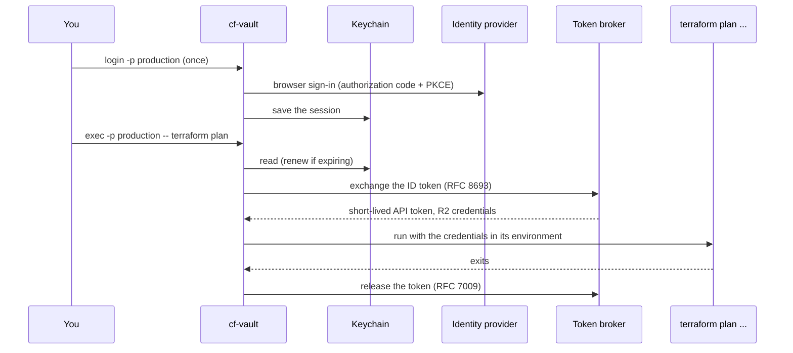

# cf-vault

[](https://github.com/cf-contrib/cf-vault/actions/workflows/ci.yml)
[](https://github.com/cf-contrib/cf-vault/releases/latest)
[](rust-toolchain.toml)
[](#install)
[](LICENSE)

Manage Cloudflare credentials without keeping them in shell profiles, dotfiles or CI variables.
cf-vault signs you in, keeps the session in your system keychain, and runs a command with
short-lived Cloudflare credentials in its environment for that command only. It is inspired by
[aws-vault](https://github.com/99designs/aws-vault) and
[nix-vault](https://github.com/nixos-contrib/nix-vault).

> [!WARNING]
> **Pre-1.0.** The configuration file's keys and the command line may still
> change between minor versions.

```bash
cf-vault login -p production                      # once: browser sign-in
cf-vault exec -p production -- terraform plan     # credentials exist only for this command
```

## How it works



The session lives in the keychain. The command gets the credentials in its own environment and
nothing else does: no shell profile, dotfile or CI variable holds them. Profiles without a broker
skip the exchange and deliver the stored API token, or temporary R2 credentials derived from it.

## Pick your setup

| You want | Use | Read |
|----------|-----|------|
| Team access with policy-scoped, short-lived tokens and R2 credentials | an `oauth2` profile with `exchange` at a [cloudflare-sts](https://github.com/cf-contrib/cloudflare-sts) broker, or any other RFC 8693 broker | [Broker](docs/broker.md) |
| A broker that publishes metadata | `issuer` instead of the endpoints | [Endpoint discovery](docs/configuration.md#endpoint-discovery) |
| Your own identity provider, or Cloudflare's own sign-in with your own client | an `oauth2` profile with `issuer` and `client_id` | [Cloudflare OAuth](docs/cloudflare-oauth.md) |
| A plain API token kept in the keychain | an `api_token` profile | [Configuration](docs/configuration.md) |
| Temporary R2 credentials, from a broker, an API token or Cloudflare's own OAuth | an `[r2]` table, or a broker bucket | [R2](docs/r2.md) |
| CI, or a machine with no keychain | environment variables | [CI](docs/ci.md) |

Every guide is in [docs/](docs/README.md).

## Install

```bash
nix run github:cf-contrib/cf-vault -- --help      # or: nix profile install github:cf-contrib/cf-vault
cargo binstall cf-vault                           # prebuilt binary from the GitHub release
cargo install cf-vault
```

Supported: macOS and Linux. On Linux the session goes to the Secret Service (for example
gnome-keyring or KeePassXC), so one must be running in your session. cf-vault never falls back to
another store: without a usable keychain, `login` fails. A machine without one uses environment
variables: see [CI](docs/ci.md).

## Quick start

1. **Write a profile** in `~/.config/cf-vault/config.toml`:
   ```toml
   [production]
   type = "oauth2"
   account_id = "xyz789"

   [production.oauth2.exchange]
   issuer = "https://cloudflare-sts-api.example.com"   # the broker; its metadata names the rest
   scopes = ["infra-admins:tofu-plan"]                 # what to ask the broker for
   ```
2. **Log in** once: `cf-vault login -p production`. A browser step signs you in; an `api_token`
   profile asks for a hidden token instead.
3. **Run a command** with it: `cf-vault exec -p production --ttl 30m -- terraform plan`.
4. **Check** with `cf-vault list`: names, types, accounts and session state, never a secret.

The file never holds tokens or secrets, and the whole file is validated before any command runs.
A broker that publishes metadata is named with `issuer`; one that does not is named by its
`token_endpoint`: see [endpoint discovery](docs/configuration.md#endpoint-discovery). Every key is
in [Configuration](docs/configuration.md); a full example is
[`config.example.toml`](config.example.toml).

## Commands

```text
cf-vault login  -p <name> [--no-browser]                 sign in, or store an API token
cf-vault exec   -p <name> [--ttl 10m] -- <command> ...   run a command with the credentials
cf-vault logout -p <name>                                remove the stored session
cf-vault list   [--json]                                 profiles and session state
```

What each does, the variables the command receives and the exit statuses are in
[Commands](docs/commands.md).

## Limitations

* **Cleanup is best effort** after `SIGKILL`: a broker token is then not released and expires on
  its own.
* **Credentials are not renewed while the command runs**; ask for a longer lifetime with `--ttl`.
* **R2 credentials cannot be revoked early.**
* **Cloudflare's own sign-in needs a client of your own** for now, and R2 credentials from it need the `account-api-tokens.write` scope.

The full list is in [docs/limitations.md](docs/limitations.md).

## Development

```bash
nix develop                                                         # pinned Rust toolchain
cargo fmt --check && cargo clippy --all-targets --features test-store -- -D warnings
cargo test --features test-store                                    # unit + integration tests
cargo test -- --ignored keyring_smoke                               # real keychain round trip (manual)
```

The integration tests drive the real binary against loopback mock servers (an OIDC provider, a
broker and the Cloudflare API) with fake credentials only. They need the **`test-store`** cargo
feature, which adds test hooks selected by `CF_VAULT_*` variables. It is never enabled by default
or in releases, and CI fails if a release binary contains any of them.

## License

MIT, see [LICENSE](LICENSE).
