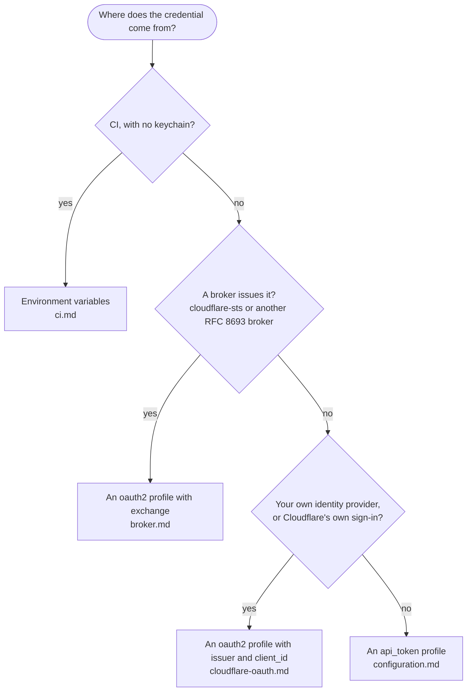

# cf-vault documentation

Which setup is yours?

| Guide | What it covers |
|-------|----------------|
| [Configuration](configuration.md) | Every key of `config.toml`, how an OAuth profile resolves, endpoint discovery, examples |
| [Commands](commands.md) | `login`, `exec`, `logout`, `list`, the variables the command receives and the exit statuses |
| [Broker](broker.md) | Trading your sign-in for short-lived Cloudflare credentials at a cloudflare-sts broker or another RFC 8693 broker; Cloudflare Access as the identity provider |
| [Cloudflare OAuth](cloudflare-oauth.md) | Signing in with Cloudflare's own OAuth through a client you register, what it can do and how it behaves |
| [R2](r2.md) | Temporary R2 credentials, and feeding Terraform's S3 backend |
| [CI](ci.md) | Running without a terminal or keychain |
| [Limitations](limitations.md) | What cf-vault does not do |
